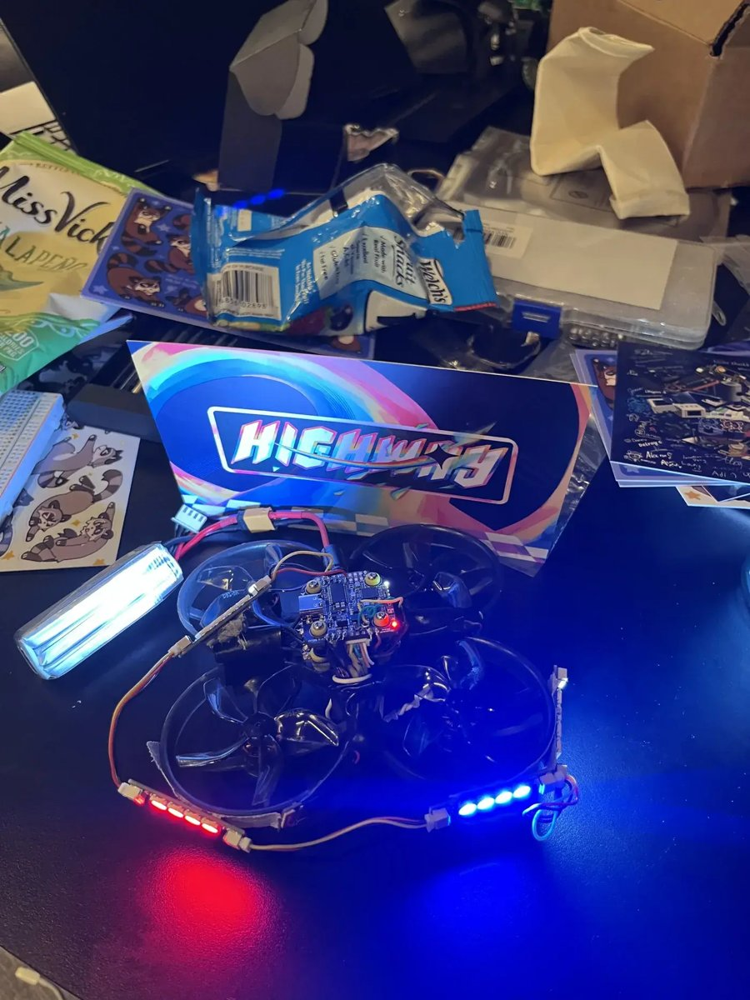
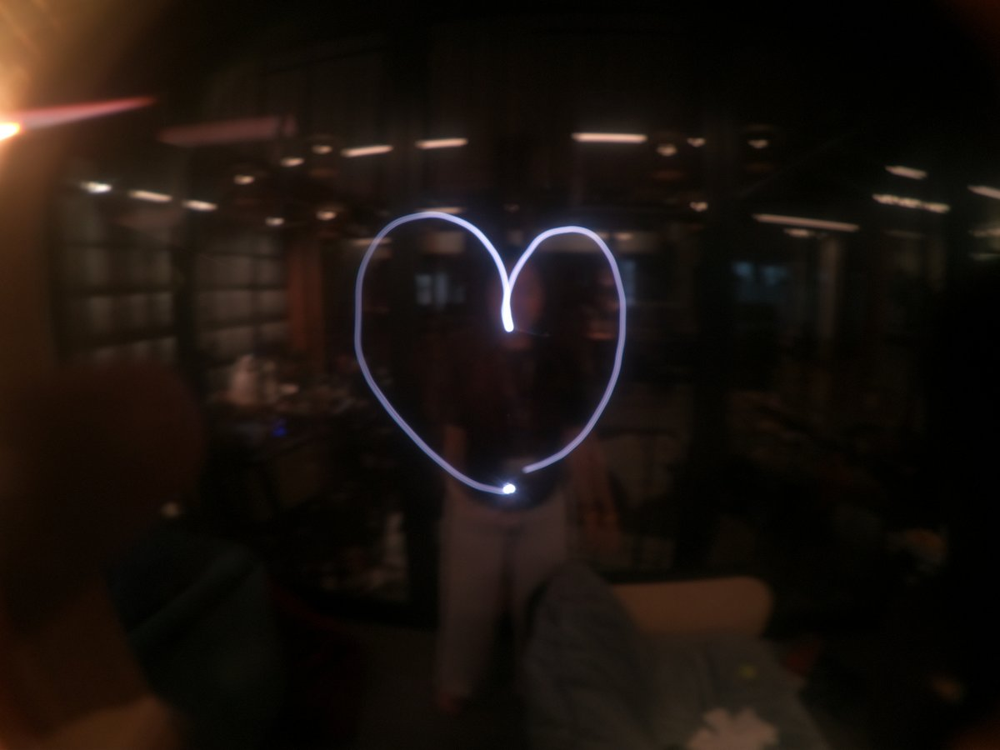
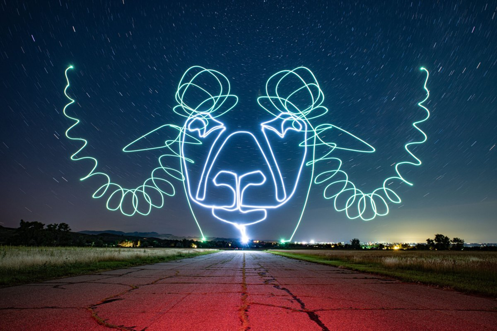

# Luminous

A mini drone for light painting. Draw a light path in the web app, set up your camera on a long exposure, and the drone flies the path with its LEDs on.

<p align="center">
  
  
</p>

## What's light painting?

A long exposure photo where a moving light draws over the scene. Doing it by hand takes a lot of retakes, so Luminous flies the path for you.

<p align="center">
  
</p>

## How it works

- **Web app:** draw the path, set LED colors on a timeline, preview the flight in 3D, and export it as an ArduPilot mission
- **Drone script:** uploads the waypoints over MAVLink and changes the LED colors as it flies
- **Optical flow and lidar sensor:** lets the drone track its position indoors

## Parts

- SpeedyBee F405 Mini flight controller
- MicoAir MTF-02P optical flow and 6 m lidar
- VCI Spark 1104 7100KV motors
- Gemfan D51 5-blade props
- Happymodel Mobula frame
- BetaFPV Lava 3S 450 mAh LiPo

## Tech

pymavlink, ardupilot

## Structure

```
app/, components/   path design web app
drone_firmware/     ArduPilot script for waypoints and LEDs
```
